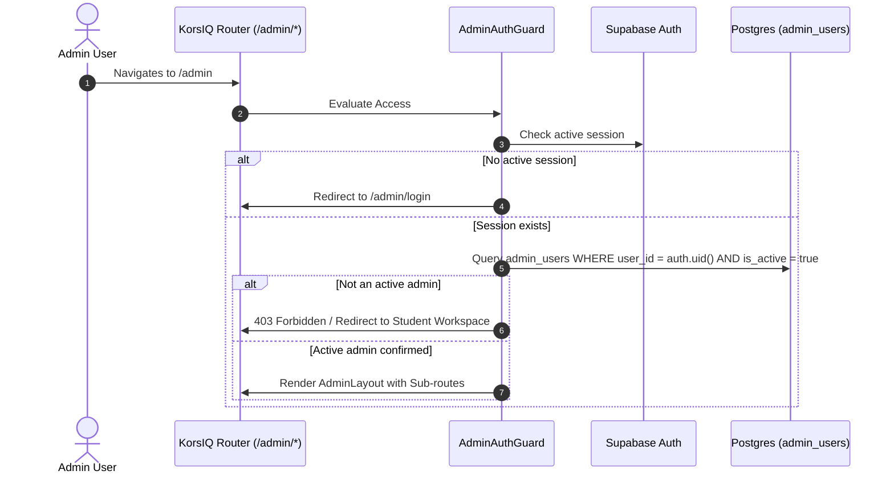
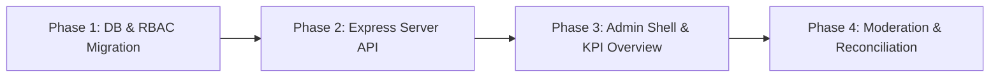

# KorsIQ Admin Portal: Architectural Plan & Specification

**Document Version:** 1.0.0  
**Status:** DRAFT (Awaiting Owner Approval — Step B of Task 6)  
**Target Branch:** `ui-rebuild`  
**Governing Standard:** `AGENTS.md` and `docs/specs/`

---

## 1. Architectural Goals & Supabase-Native Approach

### 1.1 Context & Legacy Shortcomings
The previous admin implementation relied on an ad-hoc custom authentication system using hardcoded tokens, insecure localStorage sessions, and an undocumented fallback secret (`korsiq_secure_admin_portal_secret_2026`). In addition, admin operations frequently bypassed Postgres Row Level Security (RLS) or failed silently when server endpoints were misaligned with client tokens.

### 1.2 Core Architectural Principles
1. **Supabase-Native Authentication**:
   - The admin portal strictly authenticates users through Supabase Auth (`supabase.auth.signInWithPassword` or SSO/MFA).
   - No separate token mechanism, custom JWT issuer, or client-side secret is permitted.
   - Admin status is verified server-side against an authenticated Supabase user ID (`auth.uid()`) and validated via Postgres Row-Level Security and server middleware.
2. **Server-Side Elevation with Strict Guardrails**:
   - Client components interact with admin features only through secured Express API routes (`/api/admin/*`) or authenticated Supabase queries with strict RLS policies.
   - The Express backend uses the `SUPABASE_SERVICE_ROLE_KEY` **only** on the server for necessary administrative operations (e.g. system-wide aggregate metrics, audit log appending, account status synchronization).
   - The `service_role` key is **never** sent to the client bundle (`AGENTS.md` Rule 1).
3. **Zero Fake Metrics or Mock Data**:
   - In accordance with `AGENTS.md` Rule 3 ("No fake content"), every figure, chart, count, and status badge must reflect genuine database rows (`profiles`, `subscriptions`, `study_groups`, `group_materials`, `user_files`).
   - If a table has zero rows, the UI displays genuine empty states ("0 Active Subscriptions", "No transactions recorded") rather than simulated metrics.

---

## 2. Role-Based Access Control (RBAC)

### 2.1 Schema Design: `admin_users` Table
A dedicated Postgres table tracks users granted administrative privileges:

```sql
CREATE TYPE admin_role_type AS ENUM (
  'super_admin',    -- Full system access, RBAC assignment, billing overrides, system config
  'admin',          -- User management, content moderation, university curricula management
  'support_admin',  -- Read-only user diagnostics, circle assistance, support ticket resolution
  'finance_admin'   -- Paystack transaction audit, subscription reconciliation, refund logs
);

CREATE TABLE IF NOT EXISTS public.admin_users (
  id UUID PRIMARY KEY DEFAULT gen_random_uuid(),
  user_id UUID NOT NULL REFERENCES auth.users(id) ON DELETE CASCADE,
  email TEXT NOT NULL,
  role admin_role_type NOT NULL DEFAULT 'support_admin',
  is_active BOOLEAN NOT NULL DEFAULT true,
  granted_by UUID REFERENCES auth.users(id),
  created_at TIMESTAMPTZ NOT NULL DEFAULT now(),
  updated_at TIMESTAMPTZ NOT NULL DEFAULT now(),
  CONSTRAINT uq_admin_user UNIQUE(user_id)
);
```

### 2.2 Postgres Security & Helper Functions
To enforce RBAC directly in Postgres policies and backend routes:

```sql
CREATE OR REPLACE FUNCTION public.is_korsiq_admin()
RETURNS BOOLEAN
LANGUAGE sql
SECURITY DEFINER
SET search_path = public
STABLE
AS $$
  SELECT EXISTS (
    SELECT 1 FROM public.admin_users
    WHERE user_id = auth.uid()
      AND is_active = true
  );
$$;

CREATE OR REPLACE FUNCTION public.has_admin_role(required_role admin_role_type)
RETURNS BOOLEAN
LANGUAGE sql
SECURITY DEFINER
SET search_path = public
STABLE
AS $$
  SELECT EXISTS (
    SELECT 1 FROM public.admin_users
    WHERE user_id = auth.uid()
      AND is_active = true
      AND (
        role = 'super_admin' OR
        role = required_role
      )
  );
$$;
```

### 2.3 Row Level Security (RLS) Policies
- `admin_users` table:
  - `SELECT`: Only authenticated admins can read admin rows.
  - `INSERT / UPDATE / DELETE`: Only `super_admin` can grant, alter, or revoke admin privileges.

---

## 3. Audit Logging Strategy

### 3.1 Immutability & Forensic Integrity
Every administrative action—including profile suspensions, subscription adjustments, circle moderation, or user impersonation/support lookups—must be recorded in an immutable ledger.

### 3.2 Schema Design: `admin_audit_logs`
```sql
CREATE TABLE IF NOT EXISTS public.admin_audit_logs (
  id UUID PRIMARY KEY DEFAULT gen_random_uuid(),
  actor_id UUID NOT NULL REFERENCES auth.users(id),
  actor_email TEXT NOT NULL,
  actor_role admin_role_type NOT NULL,
  action_type TEXT NOT NULL,       -- e.g. 'USER_SUSPEND', 'SUBSCRIPTION_REFUND', 'CIRCLE_DELETE'
  resource_type TEXT NOT NULL,     -- e.g. 'user', 'subscription', 'study_group', 'material'
  resource_id TEXT,                -- ID of the affected entity
  metadata JSONB NOT NULL DEFAULT '{}'::jsonb, -- Diff or snapshot of changes
  ip_address TEXT,
  user_agent TEXT,
  created_at TIMESTAMPTZ NOT NULL DEFAULT now()
);
```

### 3.3 Security Invariants
- `INSERT`: Permitted by authenticated admin sessions or backend service role.
- `UPDATE`: **REVOKED for all roles**. Logs cannot be altered.
- `DELETE`: **REVOKED for all roles**. Logs cannot be pruned or dropped.

---

## 4. Route Architecture & Navigation

### 4.1 Route Structure
The Admin Portal will live under a dedicated URL namespace:
- `/admin` (Redirects to `/admin/overview`)
- `/admin/overview` (Executive KPIs, system health, revenue snapshot)
- `/admin/users` (Student directory, account status, verification diagnostics)
- `/admin/subscriptions` (Paystack ledger, active plans, manual reconciliation)
- `/admin/circles` (Study circle moderation, reported content, file storage inspection)
- `/admin/universities` (Nigerian university database, course code mappings)
- `/admin/audit-logs` (Searchable immutable activity stream)

### 4.2 Admin Portal Guard (`AdminAuthGuard.tsx`)


### 4.3 Visual & UX Design Guardrails
- **Independent Layout**: Admin portal does not share the student sidebar; it features a dedicated dark slate command bar (`bg-slate-900` text-slate-100) with KorsIQ Admin branding.
- **Session Timeout Indicator**: Prominently shows active session expiry timer (30-minute inactivity limit).
- **"Exit to Student Workspace"**: Clear, one-click return to student dashboard (`/dashboard`).

---

## 5. Module Breakdown & Real Metrics (Zero Fake Data)

### 5.1 Executive KPI Overview
- **Total Registered Students**: Live count from `profiles`.
- **Monthly Active Students (MAU)**: Count of unique active sessions within the last 30 days (`profiles.updated_at` or `study_sessions.created_at`).
- **Active Pro Subscriptions**: Real count from `subscriptions` where `status = 'active'`.
- **Realized Paystack Revenue**: Cumulative sum from verified transactions in `payments` (converted from Kobo to NGN).
- **Study Circles Count**: Count of active groups in `study_groups`.
- **Total Storage Consumed**: Aggregated sum of `file_size_bytes` from `user_files` and `group_materials`.

### 5.2 Student & Identity Moderation
- Filterable student grid: Search by Name, Email, University, Department, Matric Number.
- Actions:
  - View full academic profile & course list.
  - Review verification status (email verified, onboarding completed).
  - Suspend / Unsuspend student account with mandatory audit reason.
  - Send password reset trigger via Supabase Auth Admin.

### 5.3 Subscription & Paystack Reconciliation
- Direct view of student subscription states (`free`, `pro`, `annual`).
- Paystack Transaction Inspector:
  - Query Paystack API live via backend to verify transaction reference.
  - "Re-sync Webhook": In case student paid on Paystack but webhook was delayed, admin can trigger instant verification and subscription activation.
  - Cancel / Deactivate subscription with refund notation.

### 5.4 Circles & Shared Content Moderation
- Monitor active study circles across Nigerian universities.
- Inspect reported discussions or message logs.
- Remove toxic messages or delete empty/abandoned circles.
- Inspect shared materials: check extraction status (`ready`, `processing`, `failed`) and trigger re-OCR when students encounter document errors.

### 5.5 University & Syllabi Management
- Directory of supported Nigerian Federal, State, and Private universities.
- Add / Update approved courses, faculties, and syllabus templates.

### 5.6 Audit Log Explorer
- Real-time tabular viewer of `admin_audit_logs`.
- Filter by Actor, Action Type, Date Range, or Resource ID.

---

## 6. Security & Hardening Checklist

| Security Control | Implementation Standard |
|---|---|
| **Secret Isolation** | Zero API keys or secrets in frontend bundle (`vite.config.ts`, `VITE_*`). Backend Express only. |
| **Authentication Enforcement** | All `/api/admin/*` routes verify Supabase bearer token and confirm membership in `admin_users`. |
| **Audit Trails** | Every state modification records actor ID, IP address, user agent, and diff metadata. |
| **Rate Limiting** | Strict rate limits on `/api/admin/*` endpoints (e.g., max 60 requests/minute per admin). |
| **Session Inactivity** | Auto-logout and session invalidation after 30 minutes of admin inactivity. |
| **Least Privilege** | Non-super admins restricted from elevating roles or accessing raw database connections. |

---

## 7. Phased Implementation Roadmap



### Phase 1: Database Foundation & RBAC Migration
- Write `supabase/migrations/20261109_admin_rbac_and_audit_logs.sql`.
- Create `admin_users` table, `admin_role_type` enum, and `admin_audit_logs` table.
- Implement RLS policies and `is_korsiq_admin()` database function.
- *Acceptance Criteria*: Unauthenticated or student users receive 0 rows from `admin_users` and cannot insert audit logs directly.

### Phase 2: Express Server Admin API & Auth Middleware
- Add `verifyAdminAuth` Express middleware in `server.ts` that validates incoming Supabase JWT and checks `admin_users`.
- Build real metrics endpoint `/api/admin/metrics` querying actual table counts.
- Build audit logging helper function.
- *Acceptance Criteria*: Unauthorized requests to `/api/admin/metrics` return HTTP 401/403. Authorized requests return real database counts.

### Phase 3: Admin UI Core Shell & Navigation
- Build `components/admin/AdminLayout.tsx`, `AdminNav.tsx`, and `AdminGuard.tsx`.
- Connect route guard to Supabase auth state.
- Build `components/admin/OverviewView.tsx` with real database KPI cards and storage consumption graphs.
- *Acceptance Criteria*: Only confirmed admin users can view the admin shell; regular students are redirected to `/dashboard`.

### Phase 4: Operational Modules (Moderation & Paystack Reconciliation)
- Build `components/admin/UsersView.tsx` (Student search, suspension toggle).
- Build `components/admin/SubscriptionsView.tsx` (Paystack sync, transaction re-verification).
- Build `components/admin/CirclesView.tsx` (Circle moderation, shared material status inspection).
- Build `components/admin/AuditLogsView.tsx` (Filterable audit stream).
- *Acceptance Criteria*: Actions in any module immediately create an immutable entry in `admin_audit_logs`.

---

> [!IMPORTANT]
> **Action Required**: This plan is submitted for review and approval. In accordance with the prompt ("write the PLAN ONLY and stop for my approval. Do not write any admin code yet"), **no admin code or migrations will be written until you review and approve this document.**
